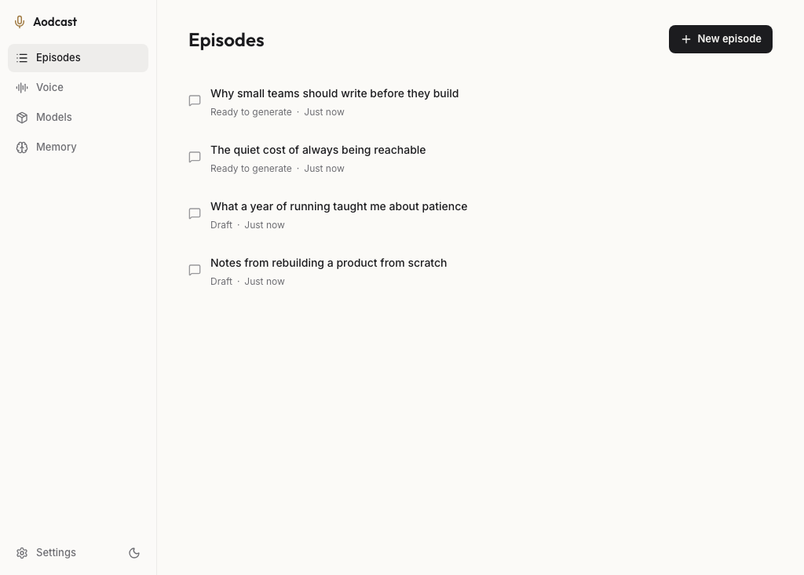

# Aodcast

[](https://github.com/Handsomemikezzz/Aodcast/actions/workflows/ci.yml)


English | [简体中文](README.zh-CN.md)

**Turn an idea, or an article you already wrote, into a solo podcast — script and voice — on your own Mac.**



> Status: alpha. Installable on Apple Silicon Macs, or run from source.

## Install

1. Download the DMG from [GitHub Releases](https://github.com/Handsomemikezzz/Aodcast/releases) (macOS, Apple Silicon) and drag Aodcast to Applications.
2. The alpha is unsigned. On first launch, right-click the app → Open, or run `xattr -dr com.apple.quarantine /Applications/Aodcast.app`.
3. Install FFmpeg (`brew install ffmpeg`).

Your data lives in `~/Library/Application Support/Aodcast`. To bring over data from a source checkout, copy the contents of its `.local-data/` there. Local voice (preset and cloned) needs the speech service, which is not in the DMG: run it from source (see Quick Start). Cloud TTS works without it.

## Why Aodcast

- **Write by talking.** An interviewer asks one question at a time and helps you draw out what you actually think, then turns the conversation into a script you can edit.
- **Start from an article.** Bring a Markdown file and get a podcast adaptation or a faithful narration, at the length you want.
- **Local voice, including your own.** Speech runs on your Apple Silicon Mac. Pick a built-in voice, or clone one from a short recording of the speaker.
- **Local-first and private.** Your episodes, scripts, voices and audio stay on your machine.

## How it works

1. **Start** with an idea or import a Markdown article.
2. **Talk it through.** Answer the interviewer, or pick one of its suggested answers.
3. **Get a script.** Generate as many drafts as you like and edit them freely.
4. **Pick a voice.** Choose a built-in voice or a voice you cloned, and preview a passage.
5. **Render the audio** and export it as WAV or MP3.

## Requirements

- Apple Silicon macOS
- Python 3.13+ (the bundled speech service uses its own Python 3.12, managed by `uv`)
- `uv`, Node.js, `pnpm`, Rust and Cargo
- `curl` and `lsof`
- FFmpeg (`brew install ffmpeg`)

Check your toolchain with `./scripts/dev/check-toolchain.sh`.

## Quick Start

From the repository root:

```bash
cd speech-service
uv sync --frozen
cp .env.example .env

cd ../services/python-core
uv sync --extra test

cd ../../apps/desktop
pnpm install

cd ../..
./scripts/dev/run-dev-all.sh
```

This starts the local speech service, the Python runtime and the desktop app. Press `Ctrl+C` to stop the app; the shared speech service keeps running until you stop it:

```bash
./speech-service/service.sh stop
```

## Configure a model

Open **Settings** and choose how Aodcast writes your scripts. Full CLI flags are in [CONTRIBUTING.md](CONTRIBUTING.md#provider-setup).

- **Mock** — no account needed, for trying the interview and script flow. Audio still needs the local speech service or a remote TTS provider.
- **ChatGPT subscription (via Codex)** — install the official Codex CLI (`npm install -g @openai/codex`) and sign in from Settings. Your plan allowance is used; Aodcast never falls back to API-key billing.
- **OpenAI-compatible** — any compatible endpoint with a base URL, model and API key.

## Data & Privacy

- Everything lives under `~/Library/Application Support/Aodcast` (installed app) or `.local-data/` in the repository (source runs, ignored by Git; never commit it).
- There is no Keychain integration yet: API keys are stored as local configuration, so protect your config files, logs, backups and synced folders.
- For ChatGPT subscription access, Codex owns sign-in and tokens. Aodcast never reads or stores them.
- With a remote LLM provider, your conversation, imported article and attachments are sent to that provider under its terms.
- Memory is opt-in and local. You can view, switch off and delete it, and it never stores secrets such as passwords or API keys.
- Chat attachments and imported articles never become memory.
- Full details: [ARCHITECTURE.md](ARCHITECTURE.md#data-and-privacy-details).

## More

- [ARCHITECTURE.md](ARCHITECTURE.md) — how the product behaves and where its limits are
- [CONTRIBUTING.md](CONTRIBUTING.md) — development commands, provider setup, speech service, verification
- [SECURITY.md](SECURITY.md) and [CHANGELOG.md](CHANGELOG.md)
- [AGENTS.md](AGENTS.md) — collaboration contract for coding agents

## Contributing

Contributions are welcome. Keep changes small, update docs when behavior changes, and never commit `.local-data/`, `.env`, model weights, generated audio or credentials. See [CONTRIBUTING.md](CONTRIBUTING.md).

## Security

If you find a vulnerability, do not open a public issue with exploit details. Report it privately to `cxh1210@mail.ustc.edu.cn` or follow [SECURITY.md](SECURITY.md).

## License

Aodcast is released under the [MIT License](LICENSE).
