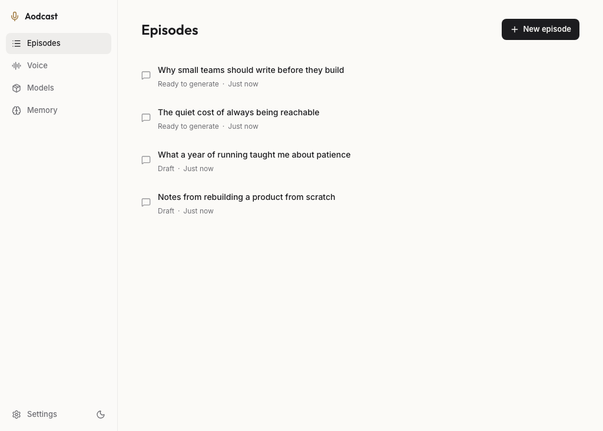

# Aodcast

[](https://github.com/Handsomemikezzz/Aodcast/actions/workflows/ci.yml)


[English](README.md) | 简体中文

**在自己的 Mac 上，把一个想法或一篇现成的文章，变成一期单人播客——脚本和声音都有。**



> 当前状态：源码级 alpha。目前需从源码运行，尚无打包发行版。

## 为什么用 Aodcast

- **聊着聊着就写好了。** 访谈者一次只问一个问题，帮你把真正的想法说出来，再把对话整理成可编辑的脚本。
- **从文章出发。** 导入 Markdown 文件，按想要的时长改写成播客，或忠实朗读。
- **本机语音，还能用你自己的声音。** 语音在你的 Apple Silicon Mac 上生成。可选内置音色，也可以用一小段录音克隆某个人的声音。
- **本地优先，注重隐私。** 节目、脚本、音色和音频都留在你的电脑上。

## 它是怎么工作的

1. **开始**：写下一个想法，或导入一篇 Markdown 文章。
2. **聊一聊**：回答访谈者的提问，也可以直接选它给出的候选回答。
3. **得到脚本**：可以生成多份草稿，并随意修改。
4. **选声音**：选择内置音色或你克隆的声音，先试听一小段。
5. **生成音频**，导出 WAV 或 MP3。

## 环境要求

- Apple Silicon macOS
- Python 3.13+（内置语音服务使用独立的 Python 3.12，由 `uv` 管理）
- `uv`、Node.js、`pnpm`、Rust 和 Cargo
- `curl` 和 `lsof`
- FFmpeg（`brew install ffmpeg`）

可用 `./scripts/dev/check-toolchain.sh` 检查本机工具链。

## 快速开始

在仓库根目录执行：

```bash
cd speech-service
uv sync --frozen
cp .env.example .env

cd ../services/python-core
uv sync --extra test

cd ../../apps/desktop
pnpm install

cd ../..
./scripts/dev/run-dev-all.sh
```

该命令会依次启动本机语音服务、Python runtime 和桌面应用。按 `Ctrl+C` 可退出应用；共享的语音服务会继续运行，需要时手动停止：

```bash
./speech-service/service.sh stop
```

## 配置模型

在 **Settings** 中选择 Aodcast 用哪个模型来写脚本。完整的命令行参数见 [CONTRIBUTING.md](CONTRIBUTING.md#provider-setup)。

- **Mock**：无需账号，用来体验访谈和脚本流程。音频仍需本机语音服务或远程 TTS provider。
- **ChatGPT 订阅（通过 Codex）**：安装官方 Codex CLI（`npm install -g @openai/codex`），在 Settings 中登录即可。消耗的是你的订阅额度，Aodcast 不会回退到 API key 计费。
- **OpenAI-compatible**：任意兼容接口，填写 base URL、模型和 API key。

## 数据与隐私

- 所有数据都保存在仓库内的 `.local-data/` 目录，已被 Git 忽略，请勿提交。
- 目前没有 Keychain 集成：API key 以本地配置形式保存，请妥善保管配置文件、日志、备份和同步目录。
- 使用 ChatGPT 订阅时，登录和令牌由 Codex 管理，Aodcast 不会读取或保存。
- 使用远程 LLM 时，你的对话、导入的文章和附件会按该服务商的条款发送给它。
- 记忆功能默认需主动开启，数据只在本地，可查看、关闭和删除，且不会保存密码、API key 等敏感信息。
- 对话附件和导入的文章不会成为记忆。

## 更多

- [ARCHITECTURE.md](ARCHITECTURE.md)：产品行为与能力边界（英文）
- [CONTRIBUTING.md](CONTRIBUTING.md)：开发命令、Provider 配置、语音服务、验证方式（英文）
- [SECURITY.md](SECURITY.md) 和 [CHANGELOG.md](CHANGELOG.md)
- [AGENTS.md](AGENTS.md)：面向编码 agent 的协作约定

## 贡献

欢迎贡献。请保持改动小而清晰，行为变化时同步更新文档，且不要提交 `.local-data/`、`.env`、模型权重、生成的音频或任何凭据。详见 [CONTRIBUTING.md](CONTRIBUTING.md)。

## 安全

如发现漏洞，请不要公开提交包含利用细节的 issue。请私下发送到 `cxh1210@mail.ustc.edu.cn`，或参阅 [SECURITY.md](SECURITY.md)。

## License

Aodcast 基于 [MIT License](LICENSE) 发布。
