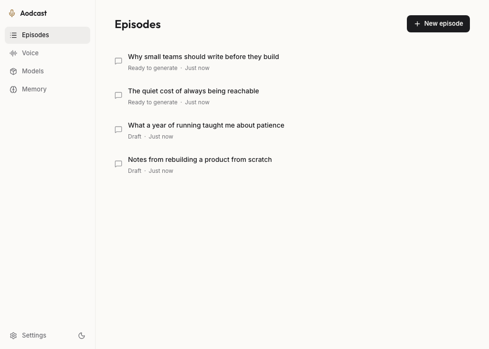

# Aodcast

[](https://github.com/Handsomemikezzz/Aodcast/actions/workflows/ci.yml)


[English](README.md) | 简体中文

Aodcast 是一个开源、本地优先的 macOS 桌面应用，用于把一个文本想法或现有 Markdown 文章转成单人播客脚本和最终音频。

应用由 Tauri 桌面壳和本地 Python HTTP runtime 组成，引导用户完成访谈、生成可编辑的脚本快照，并通过本地或远程语音 provider 渲染最终音频。本机合成使用仓库内置 `speech-service` 提供的预设音色，服务以独立进程运行；Speaker Reference 仍可作为参考音频资产管理，不代表本机服务支持克隆。

> 当前状态：源码级 alpha。Aodcast 可用于本地开发和验证，但还不是经过完整加固的桌面发行版。Provider key 和生成内容存储在本机；目前没有 macOS Keychain 或专用密钥保险库集成。

## 当前可用能力

- 基于文本主题的访谈式播客创作流程。
- 对话回复完成或点击停止后即可继续发送；文字动画和后台会话刷新不会阻塞下一条消息。
- 对话附件：可粘贴、拖放或选择图片（PNG/JPEG/WebP/GIF）和文档（TXT/Markdown/CSV/JSON/PDF，单个不超过 10 MB，每条消息最多 8 个）。图片以图像输入发送给模型；文档在本地提取文本后以文本发送。
- 支持导入本地 `.md` 文件或粘贴 Markdown，通过来源预览、播客化改写或忠实朗读、目标时长、可选来源讨论和版本化替换来创建播客。
- 每个 episode 都可以生成多个独立脚本快照，无论它来自访谈还是 Markdown。
- 脚本生成采用 Podcast Editor 行为，生成干净、适合听觉理解的口播稿，通过句子长短、标点和段落节奏安排呼吸，不人为制造 filler 或舞台指令。
- 内部 Speech Director 为精确的脚本 hash 生成版本化、provider-neutral 的 Speech Plan，包含稳定分段、结构化停顿、重音、发音和表达指导，但主 UI 不暴露这些工程概念。
- 以脚本为核心的 Episode Workspace 支持编辑、上下文内 Voice 与 Delivery 选择、短片段试听、完整音频生成、非破坏式更新、播放和导出。
- Voice Studio 支持内置和用户创建的 Speaker Reference、最长 10 分钟的样本上传/录音、资产试听和 reference 管理；已有 Voice 直接在 Episode 内选择。
- 仓库内置原生 TTS/ASR `speech-service`，由轻量级 `local_http` 客户端调用，同时支持 OpenAI-compatible 远程 TTS provider。模型加载与下载由服务的独立进程和环境负责。
- 通过 Render Manifest 装配 WAV，显式处理停顿、格式/响度一致性、渲染血缘和可复用分段音频资产。
- Models 页面展示本机语音服务状态，以及服务报告的当前模型。
- Mock LLM provider 可用于无付费 API 的访谈与脚本 smoke test；音频渲染仍需运行中的本机语音服务或已配置的远程 TTS provider。
- 可通过官方本地 Codex app-server 使用 ChatGPT 订阅额度，支持浏览器登录、账户模型发现和 Codex 使用窗口展示。
- 开发期本地数据默认存储在 `.local-data/`。

## 截图

### Episodes

从首页创建和管理播客 episode。



后续如需更新截图：运行 `./scripts/dev/run-dev-all.sh`，截取当前界面，以稳定文件名保存到 `images/`，并同步更新 `README.md` 与 `README.zh-CN.md`。请勿包含 API key、本地路径、私人 prompt 或用户数据。

## 环境要求

- Apple Silicon macOS，用于运行桌面应用和 MLX 语音服务
- 编排核心使用 Python 3.13+，`speech-service` 使用 Python 3.12，由 `uv` 分别管理
- `uv`
- Node.js
- `pnpm`
- Rust 和 Cargo
- `curl` 和 `lsof`，用于开发启动脚本
- FFmpeg，用于内置语音服务及可选 MP3 导出（`brew install ffmpeg`）

检查本机工具链：

```bash
./scripts/dev/check-toolchain.sh
```

## 快速启动

在仓库根目录执行：

```bash
cd speech-service
uv sync --frozen
cp .env.example .env

cd ../services/python-core
uv sync --extra test

cd ../../apps/desktop
pnpm install

cd ../..
./scripts/dev/run-dev-all.sh
```

`run-dev-all.sh` 先启动 `speech-service`，等待 `http://127.0.0.1:8090/health` 就绪，再启动 `127.0.0.1:8765` 上的 Python runtime，最后启动 Tauri 桌面壳和 `http://localhost:1420` 上的 Vite。浏览器版 `./scripts/dev/run-web-with-runtime.sh` 采用相同顺序。健康检查不预热模型；首次合成或识别时才加载权重。

### 日常启动与关闭

安装依赖后，在仓库根目录执行一行命令：

```bash
./scripts/dev/run-dev-all.sh
```

本机目录布局为 `AudioS/Aodcast/`，语音服务位于 `Aodcast/speech-service/`。项目也可放在其他位置；启动器根据仓库位置解析路径。

直接执行 `pnpm --dir apps/desktop tauri:dev` 时，也会先检查并启动语音服务，再启动 Web 外壳。

在启动器终端按 `Ctrl+C`，停止开发版应用及该启动器管理的 runtime；明确复用的独立 runtime 会保留。共享语音进程继续供其他客户端使用，需要显式关闭：

```bash
./speech-service/service.sh stop
```

手动管理语音时，执行 `./speech-service/service.sh start|stop|restart|status|logs`（选择其中一个动作）。`start` 安装并启用当前用户的 LaunchAgent `com.aodcast.speech-service`（包括登录自启），`stop` 禁用它；日志位于 `~/Library/Logs/Aodcast/speech-service/`。关闭 Aodcast 不会关闭语音服务。空闲卸载会释放模型权重，HTTP 进程仍保持运行。

| 组件 | 地址 | 职责与检查 |
| --- | --- | --- |
| Aodcast 界面 | 开发模式 `http://localhost:1420` | Tauri + Vite，由终端启动器运行 |
| Aodcast Python runtime | `http://127.0.0.1:8765` | 访谈、脚本、任务、音频资产；`GET /healthz` |
| 内置语音服务 | `http://127.0.0.1:8090` | TTS/ASR 模型及 GPU 内存；`GET /health` |

```bash
curl --fail http://127.0.0.1:8765/healthz
curl --fail http://127.0.0.1:8090/health
```

首次请求前或空闲卸载后，语音健康状态中的 `loaded: false` 是正常现象。Models 页面显示服务实际配置的模型及可用状态；编排 UI 不负责安装或切换模型权重。

## 第一次 Smoke Test

建议先使用 mock LLM provider，无需付费 API 即可验证访谈与脚本主流程。在仓库根目录执行：

```bash
./scripts/dev/run-python-core.sh --configure-llm-provider mock
./scripts/dev/run-python-core.sh --configure-tts-provider local_http
./scripts/dev/run-python-core.sh --create-demo-session
./scripts/dev/run-dev-all.sh
```

进入应用后，创建或打开一个 Episode，继续对话、获得 Draft，然后在 Episode Workspace 中试听或生成完整音频。

## Provider 配置

Provider 设置保存在本机 `.local-data/` 下，不应纳入版本控制。

### 开发用 Mock LLM

无需付费 API 时，可先用 mock LLM 做访谈与脚本生成的 smoke test：

```bash
./scripts/dev/run-python-core.sh --configure-llm-provider mock
./scripts/dev/run-python-core.sh --configure-tts-provider local_http
```

检查当前 LLM 配置是否可用于访谈和脚本生成：

```bash
./scripts/dev/run-python-core.sh --check-llm-config
```

### 通过 Codex 使用 ChatGPT 订阅

安装官方 Codex CLI，然后在设置中选择 **ChatGPT subscription (via Codex)**：

```bash
npm install -g @openai/codex
```

Aodcast 会启动官方本地 `codex app-server`、打开 ChatGPT 浏览器登录，并发现该账户可用的模型。访谈、总结、脚本、Speech Plan 和记忆调用使用临时 Codex thread，消耗当前账户的 Codex 计划额度。Aodcast 不读取或保存 Codex access/refresh token，也不会静默回退到 API Key 计费。登录状态与同一台机器上的官方 Codex CLI 共享。

设置中还提供一个作用于所有 Codex LLM 任务的全局 **Reasoning effort** 选择器。`Auto` 不发送 turn override，使用所选模型实时报告的默认值；显式档位来自该模型的 `supportedReasoningEfforts`。切换模型后，如果原档位不再受支持，会自动回到 `Auto`。更高强度通常会增加等待时间并更快消耗计划额度。

账户已经通过 `codex login` 登录后，也可以只用 CLI 配置 provider：

```bash
./scripts/dev/run-python-core.sh \
  --configure-llm-provider codex_subscription \
  --llm-model "gpt-5.6-sol" \
  --llm-reasoning-effort auto
```

### OpenAI-Compatible Provider

配置 OpenAI-compatible LLM provider：

```bash
./scripts/dev/run-python-core.sh \
  --configure-llm-provider openai_compatible \
  --llm-base-url "https://api.openai.com/v1" \
  --llm-model "gpt-4o-mini" \
  --llm-api-key "<your-key>"
```

配置 OpenAI-compatible TTS provider：

```bash
./scripts/dev/run-python-core.sh \
  --configure-tts-provider openai_compatible \
  --tts-base-url "https://api.openai.com/v1" \
  --tts-model "gpt-4o-mini-tts" \
  --tts-api-key "<your-key>" \
  --tts-voice "alloy" \
  --tts-audio-format "wav"
```

### 环境变量

正常开发不强制要求 `.env`。`.env.example` 记录了用于让并行 worktree 的 Vite shell 指向独立本地 runtime 的 `VITE_AODCAST_RUNTIME_URL`。`AODCAST_SPEECH_URL` 在 provider 未保存 base URL 时提供默认语音地址；已保存的 `--tts-base-url` 优先。该变量需在启动应用前通过 `export` 传入进程，Python core 不会自动读取 `.env`。语音模型及可选的 Hugging Face 镜像、token、缓存配置放在 `speech-service/.env`，由语音服务自行读取；权重仍在仓库外的 Hugging Face 缓存中，不提交到 Git。如果 Codex 不在 `PATH`、`/opt/homebrew/bin` 或 `/usr/local/bin`，请把 `AODCAST_CODEX_BIN` 设置为官方 Codex 可执行文件的绝对路径。

### 导出 MP3

最终成片仍是 WAV。音频生成后，在成片旁点击 **Export**。MP3 转换要求本机安装 FFmpeg。

- Aodcast 会在 WAV 旁边写出一份 192 kbps 的 MP3，例如 `.local-data/exports/<session-id>/renders/<render-id>/podcast.mp3`。
- Finder 会打开该 MP3，随后可手动上传小宇宙或其他平台。
- Aodcast 不保存平台凭据、不直接上传、不生成 RSS，也不维护远端发布状态。

### 内置本机语音服务

Aodcast 默认 TTS provider 为 `local_http`，通过 `httpx` 调用仓库内置的 macOS 原生 `speech-service`，地址为 `http://127.0.0.1:8090/v1`。服务源码随仓库发布，推理仍运行在独立进程和 Python 3.12 `.venv` 中；编排核心使用独立 Python 3.13+ 环境，不导入推理库。配置和内存限制见[服务说明](speech-service/README.md)。

桌面和 Web 启动器会自动启动语音。也可从仓库根目录单独管理：

```bash
./speech-service/service.sh start
curl http://127.0.0.1:8090/health
```

回到 Aodcast 项目根目录配置：

```bash
./scripts/dev/run-python-core.sh \
  --configure-tts-provider local_http \
  --tts-base-url http://127.0.0.1:8090/v1 \
  --tts-voice "默认中文音色" \
  --tts-audio-format wav
./scripts/dev/run-python-core.sh --show-local-tts-capability
```

| 请求 | 契约 |
| --- | --- |
| `POST /v1/audio/speech` | JSON 包含 `input`、`voice` 和 `response_format: "wav"`；返回 PCM WAV 字节。`默认中文音色` 使用服务默认音色。 |
| `POST /v1/audio/transcriptions` | Multipart `file` 上传（WAV、MP3、M4A）；JSON 返回 `text`。 |
| `GET /health` | 已加载模型状态与进程内存。 |

服务默认模型为 `mlx-community/Qwen3-TTS-12Hz-0.6B-CustomVoice-8bit`（TTS）和 `mlx-community/Qwen3-ASR-0.6B-8bit`（ASR）。若使用 `mlx-community/Kokoro-82M-bf16`，请修改 `speech-service/.env` 中的 `TTS_MODEL`、`TTS_VOICE=zf_xiaobei`、`TTS_LANGUAGE=z`，运行 `(cd speech-service && uv sync --frozen --extra kokoro)`，然后 `./speech-service/service.sh restart`。可选的 `HF_ENDPOINT=https://hf-mirror.com` 也配置在服务环境中。编排核心不再提供模型下载器、权重路径设置或模型目录迁移；模型获取与缓存由内置服务负责。

Aodcast 完整传递自然段，包括超过 1,000 字的段落。防 OOM 切片、串行 GPU 推理、静音裁剪、交叉淡化、缓存清理与空闲模型卸载均由语音服务负责。Aodcast 保留 Speech Plan、不可变自然段音频和 Render Manifest，用于节目装配与局部重生成；这些是编辑发布资产。HTTP 客户端读取超时为 1,800 秒，连接超时为 5 秒。服务未启动时会明确提示运行 `./speech-service/service.sh start`。

#### Python 语音识别

在 `services/python-core` 执行 `uv sync --extra test` 后：

```python
from app.providers.local_speech.client import LocalSpeechClient

client = LocalSpeechClient()
text = client.transcribe("/absolute/path/to/audio.wav", language="zh")
print(text)
```

ASR 是新增的 Python 客户端能力，尚未形成麦克风输入或字幕编辑 UI 流程。

#### 能力与限制

- 当前本机服务支持预设音色、WAV 输出、正常语速（`1.0`）及语音识别。
- 不支持音色克隆、风格指令、精确 Speech Plan 停顿或前文音频条件，遇到这些请求必须明确反馈能力限制。请使用自然标点调整节奏；标点不等于精确停顿契约。
- Voice Studio 继续管理参考音频资产，支持最长 10 分钟且附匹配文本的上传或录音。这些资产不能通过 `local_http` 克隆为音色，请选择受支持的预设音色。
- 首次请求可能因加载或下载模型较慢。空闲卸载释放模型权重与缓存，但常驻服务进程仍占用内存。
- 完整节目渲染仍保存编辑用 Speech Plan、生成自然段 WAV，并装配发布 `podcast.wav`。MP3 仍通过可选 FFmpeg 转换导出。
- `.mp4` 仅作为 Speaker Reference 音频容器输入并规范化为 WAV；Aodcast 不生成视频 MP4。

#### 真实模型联调复跑

在 `services/python-core` 执行真实 TTS→ASR 闭环及 1246 字播客管线验证：

```bash
uv run --extra test python ../../scripts/verification/verify-local-speech.py
```

脚本会在新的 `.local-data/speech-verification/<timestamp>/` 目录保存 WAV、`results.json` 和每秒内存采样 `memory.jsonl`。语音模型使用真实推理，只有编辑规划使用确定性的 mock LLM；通过识别长音频结束语检查是否截断。

2026-10-15 的 16 GiB Apple M4 实测：首次 TTS 含加载耗时 51.00 秒，得到 9.04 秒短音频；ASR 用 9.20 秒识别回正文，规整字符错误率为 0%；1246 字完整自然段耗时 207.94 秒，得到 266.31 秒音频，服务端完成 11 个切片。服务 RSS 峰值为 2.07 GiB、Metal 分配峰值为 6.68 GiB，两种口径不能相加。这是此前解耦验收时的实测，并非本次迁移的新基准或性能保证；原始产物见[验收报告](SPEECH_DECOUPLING_REPORT.md)。

## 开发命令

启动桌面应用和本地 runtime：

```bash
./scripts/dev/run-dev-all.sh
```

只启动 Python runtime：

```bash
./scripts/dev/run-python-core.sh --serve-http --host 127.0.0.1 --port 8765
```

前端检查：

```bash
pnpm --dir apps/desktop check
pnpm --dir apps/desktop test
pnpm --dir apps/desktop build:web
```

Tauri Rust 检查：

```bash
cd apps/desktop/src-tauri
cargo check
```

Python 测试：

```bash
cd services/python-core
uv sync --extra test
uv run ruff check .
uv run python -m unittest discover -s tests -v
```

仓库 hygiene 检查：

```bash
./scripts/maintenance/run-repo-hygiene-check.sh
```

## 仓库结构

- `apps/desktop`：Tauri UI、React 路由、桌面命令和前端 bridge。
- `speech-service`：内置 MLX TTS/ASR HTTP 服务、独立 Python 3.12 环境和 launchd 管理脚本。
- `services/python-core`：访谈编排、脚本生成、provider 分发、本地存储、artifact 和 HTTP runtime。
- `packages/shared-schemas`：前后端共享 contract schema。
- `scripts`：开发和维护辅助脚本。
- `docs`：被 Git 忽略的本地草稿目录（例如 `tmp.md`、`plan.md`）；人读安装说明见 README；Agent 约束见 AGENTS.md。

常用文档：

- [Agent collaboration contract](AGENTS.md)
- [Contributing guide](CONTRIBUTING.md)
- [Security policy](SECURITY.md)

## 数据与隐私

Aodcast 是本地优先应用。开发期间，生成的 session、导入来源快照、脚本、Speech Plan、Render Manifest、Speaker Reference、transcript、音频 artifact、provider 配置和 request-state 文件存储在：

```text
.local-data/
```

该目录已被 Git 忽略，不应提交。

API key 作为本地用户配置保存。Aodcast 目前没有 macOS Keychain 或专用密钥保险库。请保护本地配置文件、shell history、日志、截图、备份、同步目录、生成 transcript 和生成音频。

使用 ChatGPT 订阅时，OAuth 存储和 token 刷新由 Codex 自己管理。Aodcast 只接收账户连接状态、计划标签、模型元数据、额度摘要和生成结果；OAuth token 与浏览器 Cookie 不会进入 Aodcast 配置或 bridge payload。

导入的 Markdown 快照保存在 `.local-data/sessions/<session-id>/source.json`。生成脚本时，规范化文章、生成偏好以及后续来源讨论会发送给用户配置的 LLM provider；如果使用远程 provider，这些内容会离开本机并受相应 provider 条款约束。导入来源不会被转换成 transcript turn，也不会写入 Aodcast 长期记忆；只有用户后续主动输入的对话 turn 在启用记忆时可能成为记忆候选。

对话附件以不可变、按内容 hash 命名的文件保存在 `.local-data/sessions/<session-id>/attachments/`。每轮访谈都会把对话中的附件（最近 6 张图片和最多 4 万字符的文档文本）重新发送给配置的 LLM provider。附件不会成为长期记忆。如果所选模型不支持图片输入，回复会明确报错，而不会静默丢弃图片。

长期记忆仅保存在本地。启用后，Aodcast 会把少量可复用的用户知识以 Markdown 文件形式保存在 `.local-data/memory/`，以便采访和脚本在不同 Episode 之间保持一致。记忆是可选的（首次使用会提示），可以按 Episode 或全局关闭，并且可以完整查看和删除。高敏感秘密（密码、API key、支付凭据、完整证件号、精确住址）即使用户要求也永不保存。

不要在公开 issue 或 PR 中提交 API key、私人 prompt、导入来源正文、私人生成内容、本地数据路径、transcript 或音频 artifact。

## 当前范围

Aodcast 当前聚焦本地优先的单人播客创作：

- 平台：macOS 桌面（Tauri）+ 本地 Python orchestration core
- 输入：文本主题，或每个 episode 一个本地/粘贴的 Markdown 来源
- 输出：单人播客脚本 + Episode Workspace 渲染的最终音频
- LLM：Mock、OpenAI-compatible，或通过 Codex 使用 ChatGPT 订阅
- 本机说话者身份：每个脚本选择预设音色；Speaker Reference 音频资产独立管理
- TTS：独立进程运行的内置 HTTP `speech-service`，或远程 API provider
- 记忆：文件原生、仅本地的跨 Episode 长期用户记忆

Python 语音客户端也支持文件识别。语音转文本 UI 输入、多主持人格式、强制云端后端依赖仍不在当前范围内。

应用可以服务常见音频后缀，并通过本地解码器或 `ffprobe` 校验上传的 Speaker Reference 时长。压缩音频导出依赖本机转换工具。真正的视频 MP4 输出不在当前范围内。

## 架构与行为说明

以下描述面向人和运维的产品行为。Agent 编码约束见 [AGENTS.md](AGENTS.md)。

### 访谈与脚本软提议

提供脚本生成选项需要内容维度就绪，以及最少用户回答轮数（`MIN_USER_TURNS_FOR_SCRIPT_OFFER`，默认 4）。每轮访谈会提出一个追问，并给出两个基于上下文和记忆的候选回答（A/B）以及自由回答（C）；访谈会继续追问，只把生成脚本作为次级可选动作；只有用户明确结束或选择生成时才进入生成。

### 记忆

长期记忆以文件形式保存在 `.local-data/memory/`。`entries/*.md` 是唯一 source of truth；`catalog.json` 与 `MEMORY.md` 可重建。只有用户发言可成为记忆。访谈/脚本主流程只做只读检索，且不得阻塞于后台记忆工作。

### Podcast Editor 与 Speech Director

Podcast Editor 保持脚本为纯口播正文，同时优化听觉结构、句子长度、标点和段落呼吸；不会加入 provider tag、舞台指令或人为 filler。每次完整渲染开始时，Speech Director 都会为精确的脚本 hash 创建版本化 Speech Plan。脚本一旦编辑，旧 plan 与 render 就会过期，必须先重新完整生成，才能再次局部重生成。

### Desktop bridge 与长任务

UI 通过 desktop HTTP bridge 调用本地 Python runtime。长任务（音频渲染、音色预览等）会持久化可轮询的 `request_state`，暴露进度，支持取消，并用 `run_token` 避免重入后的陈旧 UI 状态。完整渲染与上下文窗口重生成共享脚本级 task id `render_audio:<session_id>:<script_id>`；取消请求必须携带本次 run token，因此不同脚本不会互相冲突。有状态的其他长任务应串行执行，除非明确在测并发。

### Episode Workspace 与 Voice Studio

- Episode Workspace 始终以脚本为主画布；Source 与 Conversation 位于上下文抽屉，Voice 与 Delivery 位于轻量 Inspector，Preview 与完整音频控制位于常驻底部 Dock。
- 完整渲染会保存不可变的分段 WAV 与 Render Manifest，再装配 manifest 指向的最终 WAV；MP3 是该最终成片旁的按需导出。
- Preview 优先使用选中文字，其次使用当前段落或稿件开头，生成一次性试听音频，不会替换当前 Episode 成片。
- 修改脚本、Source、Voice 或 Delivery 后，旧音频仍可播放，并显示 `Audio needs update`，直到新成片成功发布。
- Voice Studio 负责可复用 Speaker Reference 资产。本机 HTTP 渲染使用 Episode 的预设音色。完整渲染时明确选择本机预设，会解除旧克隆选择，不删除参考音频源文件或历史 Render Manifest；本机试听不发送参考音频。
- 内置 reference 音频当前位于 `services/python-core/app/assets/speaker-references/`（纳入版本控制）。用户 metadata 位于 `.local-data/speaker-references/`；上传或录制的音频会规范化为不可变的 48 kHz、单声道、16-bit PCM WAV，并保存到 `.local-data/exports/_speaker_references/`。创建时必须提供匹配的参考文本；系统音频捕获尚不可用。
- 本机语音服务决定并加载当前模型；Aodcast 在每份 manifest 中记录所选 provider 和 pipeline。Speech Plan 与上下文窗口重生成合同保留在内部，不进入主 UI。
- Artifact 音频播放在 Web 与 Tauri 中都走 localhost HTTP 路由 `/api/v1/artifacts/audio`。
- Reveal in Finder 等 Tauri-only 助手不在 HTTP `DesktopBridge` 接口中。

### 本机语音职责边界

Aodcast 编排核心不包含语音模型 worker 或进程内推理。`LocalSpeechClient` 保持同步 TTS provider 契约，内部执行可取消的 HTTP 请求。内置 `speech-service` 进程负责模型加载、GPU 并发、推理切片及 ASR 解码。请求间保持固定预设音色；不会把参考音频或先前生成的音频作为克隆或连续性条件发送。

Aodcast 的 manifest 装配把自然段 WAV 规范化为统一格式，每段做一次边缘淡化，根据可听样本匹配 RMS 电平，插入编辑停顿，限制 sample peak，最终写出 `podcast.wav`。这一步是节目发布装配，服务内部另外负责推理切片间的交叉淡化。

### 开发运维

- `./scripts/dev/run-dev-all.sh` 先启动语音并等待健康检查，再默认重启 `8765` 上的 Python runtime；只有需要进程连续性时才用 `--reuse-runtime`。
- 音频渲染排障：先看 `/healthz` runtime 元数据，再看 `.local-data/runtime/request-state/*`，最后才查前端 `run_token` 过滤。
- CLI 写后读应串行（`start-interview`、`reply-session`、`generate-script`、`render-audio`、configure/show）；并行读写可能读到陈旧状态。
- 桌面打包验证用 `pnpm --dir apps/desktop tauri:build`（不要在 `--` 后追加 cargo 风格参数）。非交互 DMG 依赖 `CI=true` 跳过 Finder AppleScript 样式。
- 新建脚本先 `chmod +x` 再执行，不要让权限与执行竞态。

## 贡献

欢迎贡献。请保持变更小而可审查；当用户流程、存储形状、provider 配置、runtime 行为或开发流程变化时同步更新文档。

不要提交 `.local-data/`、`.env`、模型权重、生成音频、transcript、虚拟环境、`node_modules`、构建产物或私人凭据。

完整贡献说明见 [CONTRIBUTING.md](CONTRIBUTING.md)。

## 安全

如果发现漏洞，请不要在公开 issue 中披露利用细节。请发送到 `cxh1210@mail.ustc.edu.cn`，或按照 [SECURITY.md](SECURITY.md) 的私密报告方式处理。

## License

Aodcast 使用 [MIT License](LICENSE)。

真实模型联调结果、完整删除清单、内存实测与复跑脚本见[《解耦与清理验收报告》](SPEECH_DECOUPLING_REPORT.md)。
